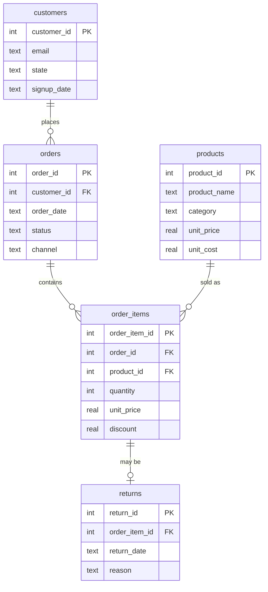

# Harbour & Home — Retail Sales Analysis in SQL

An end-to-end SQL project: designing a relational database, profiling and
cleaning messy source data, and writing queries to answer business questions
for a fictional Sydney-based online homewares retailer (calendar year 2025).

Built as part of my Professional Learning Plan (UTS 43030) to close the SQL gap
identified against Sydney data analyst job advertisements, which require
analysts to *write and troubleshoot their own queries* using joins,
aggregations, `CASE` expressions and CTEs, and to *investigate data-quality
issues* before reporting.

> **Data note:** the dataset is synthetic, produced by `generate_data.py` with a
> fixed random seed so results are reproducible. It deliberately contains
> realistic data-quality problems to clean.

---

## Database design

Five tables in third normal form:



Key design decisions:
- `order_items.unit_price` stores the price **at time of sale**, separate from the
  product's current list price.
- Primary and foreign keys, `CHECK` constraints and indexes on join columns
  (`sql/01_schema.sql`).
- Raw tables are never edited. Cleaning happens in **views**
  (`sql/03_clean_views.sql`), so it stays auditable and repeatable.

| Table | Rows |
|---|---|
| customers | 618 |
| products | 35 |
| orders | 1,100 |
| order_items | 1,857 |
| returns | 95 |

---

## Data-quality issues found and fixed

| Check | Issue found | Fix |
|---|---|---|
| DQ2 | 25 different spellings for 8 states (`nsw`, `N.S.W.`, `New South Wales`, leading spaces…) | `CASE` mapping to standard codes |
| DQ3 | 18 customers with duplicate accounts (same email, different case or whitespace) | Merged onto earliest `customer_id` using `MIN() OVER (PARTITION BY email)` |
| DQ4 | 13 customers missing a signup date | Kept as NULL; not needed for sales analysis |
| DQ5 | Order status in mixed case (`completed`, `Completed`, `COMPLETED`) | `LOWER(TRIM())` — 44 completed orders would otherwise have been dropped |
| DQ6 | 10 order lines with zero or negative quantity | Excluded from sales |
| DQ7 | 15 orders with no line items | Identified with an anti-join; excluded automatically |
| DQ8 | Orphaned product references | None found |

---

## Business questions and findings

| # | Question | SQL techniques |
|---|---|---|
| Q1 | Monthly revenue trend and growth | CTE, `LAG()` window |
| Q2 | Revenue and margin by category | Joins, `GROUP BY`, scalar subquery |
| Q3 | Top 10 customers by lifetime value | Multi-table join, `ORDER BY … LIMIT` |
| Q4 | Revenue by state | Cleaned dimension join |
| Q5 | Return rate by category | `LEFT JOIN`, conditional aggregation |
| Q6 | Top return reasons | Window over aggregate (`SUM(COUNT(*)) OVER ()`) |
| Q7 | Repeat purchase rate | CTE, `CASE` |
| Q8 | Average order value by channel | `COUNT(DISTINCT)` |
| Q9 | Products that never sold | `NOT EXISTS` anti-join |
| Q10 | Customer segmentation (recency/frequency) | Chained CTEs, `JULIANDAY`, `CASE` |
| Q11 | Best seller in each category | `RANK() OVER (PARTITION BY …)` |
| Q12 | Black Friday impact on revenue and margin | `CASE` bucketing, date ranges |

Full output for every query is in [`results/results.md`](results/results.md).

### Key insights

1. **Strong H2 growth.** Revenue rose from ~$4.5k in January to ~$29.7k in
   December. November and December alone account for 41% of annual revenue.
2. **Bedding is the problem category.** It is the largest category by revenue (24%)
   but has a **16.8% return rate**, more than 3× Kitchen and 9× Stationery.
   Stationery has the best margin (62.9%) and the lowest returns.
3. **Black Friday trades margin for volume.** Margin during that week fell to
   46.8%, against 55.0% for the rest of the year.
4. **Retention.** 52% of buying customers placed a second order. However,
   106 customers (24%) have lapsed (no order in 120+ days) and 78 are
   at risk.
5. **Marketplace orders are the largest** ($159 AOV vs $138 on Web), even though
   Marketplace is the smallest channel by volume.
6. **Dead stock.** Two products (Copper Watering Can, Marble Coaster Set) had no
   sales all year.

### Recommendations

- Review Bedding product descriptions and sizing guides. "Changed mind",
  "Wrong size" and "Not as described" together make up 67% of all returns.
- Run a win-back campaign for the 78 at-risk customers before they lapse.
- Cap Black Friday discounts on high-margin lines rather than discounting
  across the board.
- Discontinue or relist the two products that never sold.

---

## How to run

Requires Python 3 (standard library only, no installs needed).

```bash
python generate_data.py   # writes CSVs to data/
python build_db.py        # creates retail.db from schema + CSVs
python run_queries.py     # runs sql/02–04 and writes results/results.md
```

You can also open `retail.db` in [DB Browser for SQLite](https://sqlitebrowser.org/)
or the VS Code SQLite extension and run the files in `sql/` in order.

## Repository structure

```
├── data/                  raw CSVs (generated)
├── sql/
│   ├── 01_schema.sql      tables, keys, constraints, indexes
│   ├── 02_data_quality.sql  profiling checks
│   ├── 03_clean_views.sql   cleaning layer (views)
│   └── 04_analysis.sql      business questions Q1–Q12
├── results/results.md     query output
├── generate_data.py
├── build_db.py
└── run_queries.py
```

## Tools

SQLite · SQL (CTEs, window functions, joins, conditional aggregation) · Python · Git/GitHub
