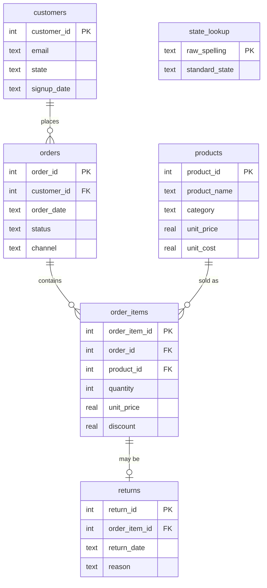

# Harbour & Home — SQL Retail Analysis

A relational database built from scratch for a fictional Sydney homewares
retailer, plus the queries used to profile, clean and analyse a full year
(2025) of its sales. Done as a hands-on exercise in schema design, data
cleaning with SQL, and answering real business questions with joins,
window functions and CTEs — the kind of SQL work that comes up constantly
in data analyst roles but rarely gets practiced end-to-end on a single
project.

> **Data note:** the dataset is synthetic (`generate_data.py`, fixed random
> seed), and it's deliberately messy — duplicate signups, inconsistent
> state labels, bad quantities, orders with no items — so there's something
> real to clean before any analysis is trustworthy.

---

## Database design

6 tables, third normal form:



Design choices worth calling out:

- **`state_lookup` is a real table, not a `CASE` expression.** Every messy
  state spelling (`"nsw"`, `"N.S.W."`, `"New South Wales"`...) maps to a
  standard code via a row in this table. Fixing a new spelling later is a
  data change (`INSERT`), not a query edit repeated across every view.
- **`order_items.unit_price`** stores what was actually charged at the time
  of sale — not `products.unit_price`, which is just today's list price.
- **Raw tables are never edited.** Every fix lives in a view
  (`sql/03_clean_views.sql`), so a cleaned number can always be traced back
  to the exact transformation that produced it.
- Primary/foreign keys, `CHECK` constraints and indexes on every join column
  are in `sql/01_schema.sql`.

| Table | Rows |
|---|---|
| customers | 618 |
| products | 35 |
| orders | 1,100 |
| order_items | 1,857 |
| returns | 95 |
| state_lookup | 18 |

---

## Data profiling

`sql/02_data_quality.sql` measures the mess before anything gets fixed —
no cleaning happens in this file.

| Area | Finding |
|---|---|
| State labels | 25 raw spellings collapse to the 8 real states/territories once run through `state_lookup` |
| Duplicate signups | 18 customers have a second account under the same email (different case/whitespace) |
| Missing signup dates | 13 customers have none |
| Order status | recorded as `completed` / `Completed` / `COMPLETED` (and similarly for `cancelled`, `pending`) — 960 completed orders exist, but a case-sensitive `= 'completed'` filter only catches 916 of them |
| Invalid quantities | 10 order lines are `0` or negative |
| Empty orders | 15 orders have no line items at all |
| Orphaned references | none found, checked anyway |

`sql/03_clean_views.sql` fixes all of the above as views (`clean_customers`,
`clean_orders`, `clean_order_items`), rolling up into one analysis-ready view,
`fact_sales` — one row per valid sold line item, already joined to customer,
product and category, with revenue, cost, margin, a return flag and a
discount-depth bucket calculated. Every query below reads from it.

---

## Findings

`sql/04_analysis.sql`, grouped into two sections:

**Customer insights** — monthly revenue trend with a running total,
top customers ranked two ways (by revenue vs. by order count — they're not
the same list), revenue and average spend per customer by state, a
recency-based lifecycle split (New / Active / At risk / Lapsed), and the
repeat-purchase rate.

**Product & operations insights** — category revenue/margin/share with a
margin ranking, the top 5 products overall by revenue, a combined
underperformers view (never-sold products alongside the weakest sellers
that did sell), return rate by category, return reasons by share, channel
performance with revenue share, a discount-depth breakdown, and Black
Friday week against the rest of the year (with a properly computed
per-day average, not a hardcoded day count).

Full output: [`results/results.md`](results/results.md).

### Key findings

1. **Revenue nearly tripled from H1 to H2.** January closed at $4.5k;
   by December it was $29.7k, with the running total showing growth
   accelerating hard from August onward. November and December alone
   account for 41% of the year's $136k revenue.
2. **Order frequency and revenue don't track together.** The customer with
   the most orders (12) isn't even in the top 5 by revenue — several
   lower-frequency customers spend more per order. Ranking by one metric
   alone would have picked the wrong "best" customers.
3. **Bedding is the category to fix.** It's the largest by revenue (24% of
   the total) but returns at 16.8% — more than 3× Kitchen (4.9%) and over
   9× Stationery (1.8%, also the best margin at 62.9%). "Changed mind" alone
   accounts for 38.9% of all returns, more than the next two reasons combined.
4. **Discounting is rare but concentrated.** 76% of sold lines carry no
   discount at all. The 10% of lines with a deep (20%) discount generate
   only 8% of revenue — discounting isn't driving much volume, it's mostly
   just giving margin away on Black Friday week specifically (margin there
   drops to 46.8% vs. 55.0% the rest of the year, despite daily revenue
   of $668 vs. $367 for an average day the rest of the year).
5. **Customer base skews recent but has a real lapsed segment.** 36% of
   buying customers ordered within the last 30 days (unsurprising given
   Nov/Dec volume), but 14.5% (64 customers) haven't ordered in 180+ days
   and a further 17% are trending that way.
6. **Marketplace is small but valuable.** It's the smallest channel by
   revenue share (14.8%) yet has the highest average order value ($159.10
   vs. $138.16 on Web, which carries half of all revenue).
7. **Two products never sold a single unit** (Copper Watering Can, Marble
   Coaster Set) all year — and the next five weakest sellers that did move
   brought in 3-5× less revenue than the top 5 products overall.

### What I'd do next

- Investigate Bedding's product pages and sizing info — "changed mind"
  dominating returns there, not "faulty" or "damaged", points at expectation
  mismatch rather than a quality problem.
- Target the 75 "at risk" customers with a win-back offer before they slide
  into the lapsed segment.
- Rethink blanket Black Friday discounting — the margin hit is real and the
  volume gain doesn't obviously need a 20% cut across the board to happen.
- Reassess the two dead-stock products and the next tier of weak sellers
  together, rather than treating "zero sales" as the only bar for action.

---

## How to run

Requires Python 3 (standard library only).

```bash
python generate_data.py   # writes CSVs to data/
python build_db.py        # creates retail.db from schema + CSVs
python run_queries.py     # runs sql/02-04 and writes results/results.md
```

Or open `retail.db` directly in [DB Browser for SQLite](https://sqlitebrowser.org/)
(or the VS Code SQLite extension) and run the files in `sql/` in order.

## Repository structure

```
├── data/                    raw CSVs (generated)
├── sql/
│   ├── 01_schema.sql        tables, keys, constraints, indexes
│   ├── 02_data_quality.sql  profiling checks (no fixes)
│   ├── 03_clean_views.sql   cleaning layer: clean_* views + fact_sales
│   └── 04_analysis.sql      business questions, grouped by @section
├── results/results.md       query output
├── generate_data.py
├── build_db.py
└── run_queries.py
```

## Tools

SQLite · SQL (CTEs, window functions, lookup-table joins, conditional
aggregation) · Python · Git/GitHub

## A note on AI assistance

The synthetic dataset and the initial project scaffold were produced with
AI assistance. The schema, cleaning approach and queries have since been all written by me.
